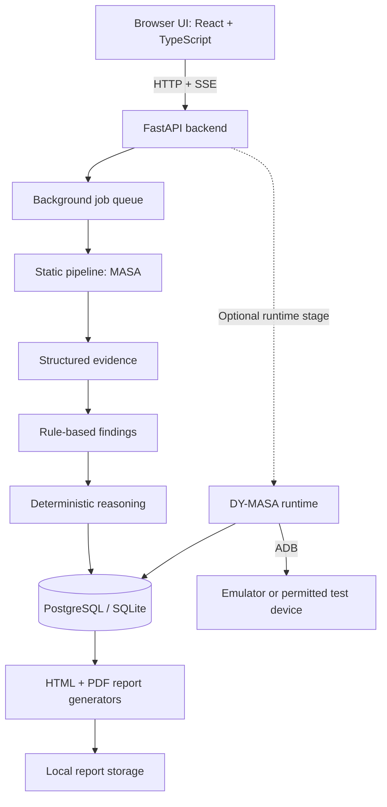
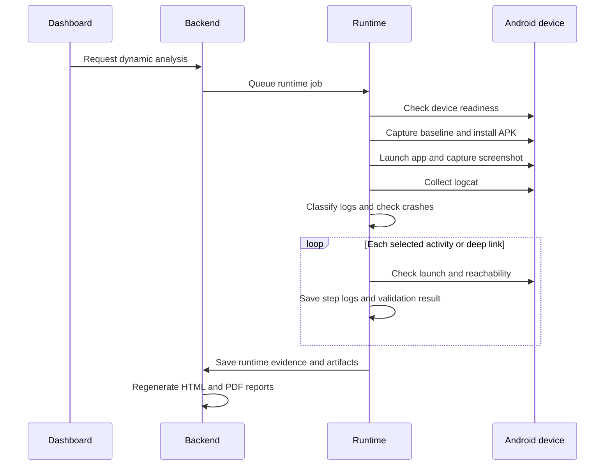

# MASA + DY-MASA

**Evidence-backed Android application security assessment: static analysis (MASA) and ADB runtime validation (DY-MASA), in one local web app.**

MASA + DY-MASA is a local workbench for assessing Android APKs. Upload an APK you own or are authorized to test, follow a tracked analysis job, inspect structured evidence and rule-based findings, optionally validate selected behavior on an Android emulator or permitted test device, and export HTML and PDF reports.

The platform is designed for traceability: findings are derived from stored evidence, and reports include scope and validation limitations.

> **Scope:** This is an automated assessment and triage tool. It reports observations and likely risks; it does not prove exploitability, guarantee detection, or replace a manual mobile penetration test. The analysis and reasoning pipeline is deterministic Python; it does not use an AI/LLM to produce findings.

## Contents

1. [What it provides](#1-what-it-provides)
2. [Features](#2-features)
3. [How it works](#3-how-it-works)
4. [Detection coverage](#4-detection-coverage)
5. [Evidence, findings, and reports](#5-evidence-findings-and-reports)
6. [Technology stack](#6-technology-stack)
7. [Architecture and project layout](#7-architecture-and-project-layout)
8. [Development approach](#8-development-approach)
9. [Getting started on Fedora/Linux](#9-getting-started-on-fedoralinux)
10. [Using the platform](#10-using-the-platform)
11. [Starting and stopping features](#11-starting-and-stopping-features)
12. [Configuration](#12-configuration)
13. [API reference](#13-api-reference)
14. [Testing](#14-testing)
15. [Safety and security model](#15-safety-and-security-model)
16. [Limitations and troubleshooting](#16-limitations-and-troubleshooting)
17. [Responsible use, license, and author](#17-responsible-use-license-and-author)

<!-- Add genuine screenshots when available:


-->

---

## 1. What it provides

The application runs locally with the backend at `127.0.0.1:8000` and the Vite frontend at `127.0.0.1:5173`.

| Input | Output |
| --- | --- |
| An APK file | A tracked analysis job, stage history, and SHA-256 fingerprint |
| APK-derived files | Structured evidence and rule-based findings with remediation guidance |
| Optional ready Android emulator or permitted test phone | Runtime observations such as install/launch results, screenshots, logcat, and selected component/deep-link checks |
| Stored evidence and findings | HTML and PDF reports with manual validation guidance and stated limitations |

The repository brings together two related parts:

- **MASA (Mobile App Security Analysis):** the static pipeline that decodes and decompiles an APK, extracts evidence, generates findings, and builds reports.
- **DY-MASA:** the optional runtime-validation stage that communicates with an Android target through ADB and adds observations to the job's evidence and reports.

Runtime analysis is separate from the static scan. A report generated after static analysis alone is expected to contain static results only; runtime evidence is added after a dynamic run completes successfully.

---

## 2. Features

### Static analysis

- APK extension and ZIP-structure validation, upload size limit, and SHA-256 fingerprint.
- APK resource/manifest decoding with apktool and DEX decompilation with JADX.
- Manifest metadata, permissions, application flags, components, deep links, FileProvider paths, and network-security configuration review.
- Exported-component analysis that accounts for Android's implicit-export behavior when an intent filter is present and `android:exported` is absent.
- Secret scanning with known-shape checks and entropy checks.
- Rule-based code-pattern checks over decompiled files.
- Optional Ghidra headless analysis of native `.so` libraries in a single shared-project batch, with an overall batch timeout sized using per-library time budgets and per-library status reporting.

### Runtime validation (DY-MASA)

- Emulator/device status and device selection, with physical-device use disabled by default.
- APK installation and launch, screenshot capture, and logcat collection.
- Logcat classification into process-related tiers and target-app crash observations.
- Selected exported-activity and deep-link launch checks, with a separate log for each validation step.
- ADB command audit and capture metadata.
- Runtime evidence and artifacts linked to the same analysis job.

### Platform

- Background analysis jobs, stage history, progress events, cancellation/deletion, and interrupted-job recovery.
- Server-Sent Events (SSE) for job progress.
- Evidence, findings, reasoning, artifacts, and report views in a React dashboard.
- HTML and PDF report generation.
- Health endpoint that checks the database and executes configured tool checks.
- PostgreSQL support and a SQLite fallback for local single-user use.
- Optional terminal route/page, disabled by default and only mounted when enabled.
- Command-line entry point for running the static pipeline on one APK.

---

## 3. How it works

### Architecture overview



### Static pipeline

1. **Upload and validate.** The backend validates the uploaded APK, applies the configured upload limit (default 300 MiB), stores it under a generated job ID, and records a SHA-256 digest.
2. **Decode and decompile.** apktool decodes APK resources and manifest data. JADX produces Java-like source where possible. Tool output is written to the job workspace.
3. **Analyze native libraries (optional).** If native `.so` libraries are present and Ghidra is enabled and configured, all libraries are imported into one shared headless Ghidra project and analyzed in a single batch. Each library still gets its own recorded status (completed, timed out, failed, skipped, or cancelled), and partial output may be kept. Ghidra coverage is not itself a vulnerability finding.
4. **Extract evidence.** Python extractors convert APK-derived data into structured evidence records with source information.
5. **Generate findings.** Deterministic rules evaluate evidence and create findings that reference evidence IDs.
6. **Summarize.** A deterministic reasoning engine groups risks and suggests manual validation paths. These summaries are not generated by an LLM.
7. **Report.** HTML and PDF reports are generated from stored job data.

### Runtime workflow



The runtime stage is intentionally limited. Exported activities and deep links may be launched for reachability checks. Exported services and providers are resolved rather than started or queried for data. Broadcast receivers and code-risk patterns are not dynamically exercised. A recorded observation is not proof of exploitability.

---

## 4. Detection coverage

The following summarizes implemented rule families. A detection is a review signal, not proof that a vulnerability is exploitable.

| Area | Example rule IDs / evidence | Typical interpretation |
| --- | --- | --- |
| Application flags | `android-debuggable-enabled`, `android-backup-enabled` | Review debug and backup configuration |
| Cleartext policy | `android-cleartext-traffic-enabled`, `android-cleartext-policy-uncertain` | Review cleartext network policy |
| Exported components | `android-exported-<type>-unprotected`, `android-exported-<type>-protected` | Review component exposure and protections |
| Entry points | `android-launcher-entry-points`, `android-exported-attribute-required-for-installation` | Informational entry-point/install compatibility notes |
| Providers | `android-exported-content-provider-review`, `android-fileprovider-path-review` | Review provider exposure and path configuration |
| Deep links | `android-wildcard-deep-links-declared`, `android-deep-links-declared` | Review declared deep-link surface |
| Permissions | `android-dangerous-permissions-requested` | Review dangerous permissions requested |
| Secrets | `android-shape-validated-hardcoded-secrets` | Review candidate hardcoded secrets |
| Code patterns | `android-code-risk-<evidence_type>` | Review selected potentially risky implementation patterns |
| Coverage | `analysis-extraction-coverage-incomplete` | Indicates extraction limits or incomplete coverage |

### Code-pattern rules

The static code-risk extractor uses pattern-based checks over selected decompiled file types, including Java/Kotlin-like sources, XML, JSON, properties, Gradle files, and Smali. Implemented rule families include:

- WebView JavaScript enablement and file-access settings.
- WebView JavaScript bridges.
- Potentially permissive TLS trust managers and hostname verifiers.
- Weak cryptographic algorithm/mode selections, including AES/ECB, DES/DESede, MD5, and SHA-1.
- Cleartext HTTP URL literals.
- Raw SQL query construction using concatenation or formatting.

Pattern matches can be false positives or miss obfuscated, dynamically generated, or otherwise unrecognized code.

### Secret scanner

The scanner combines keyword families with known-shape checks and entropy checks. It recognizes selected key/token formats and applies stricter requirements to generic values. Some generated or resource-heavy files are excluded to reduce noise. Extraction caps and unreadable/oversized-file conditions can be recorded as incomplete-coverage evidence rather than silently implying that every file was checked.

Findings can include MASVS/MSTG references and a heuristic score. A heuristic score is a triage aid, **not a calculated CVSS vector**.

---

## 5. Evidence, findings, and reports

### Evidence model

Evidence records contain structured information such as category, type, label, value, and source path. Findings reference evidence IDs so a reviewer can trace a conclusion back to the observations that triggered it. The dashboard and report generators use stored job data rather than relying only on transient console output.

Extraction limits or skipped/unreadable files may reduce coverage. Review any incomplete-coverage evidence and do not interpret an empty finding list as proof that an APK is secure.

### Logcat classification

The runtime logcat parser is implemented in Python and can be tested independently of ADB:

1. It discovers target-app process IDs from Android process-start records and tracks observed process IDs as the app restarts.
2. It classifies lines into tiers: **Tier A** for the target process, **Tier B** for selected system lifecycle lines or lines referencing the target PID/UID, and **Tier C** for other lines that mention the package.
3. The filtered log combines Tier A and Tier B while preserving the original line order and line content.
4. Crash observations are tied to the target application/process rather than triggered by a generic occurrence of the word “crash”.

Supported input formats and device-specific behavior should be checked against the Limitations section when interpreting a capture.

### Runtime artifacts

Depending on the run and device, the workspace may contain:

| Artifact | Purpose |
| --- | --- |
| `logcat.txt` | Raw logcat capture |
| `logcat-stderr.txt` | Standard error from logcat capture |
| `logcat-filtered.txt` | Tier A + Tier B lines |
| `logcat-tier-a.txt`, `logcat-tier-b.txt`, `logcat-tier-c.txt` | Individual log tiers |
| `baseline-logcat.txt` | Short capture before installation for device-noise context |
| `launch-screenshot.png` | Screenshot after app launch |
| `steps/` | Isolated logs for individual validation steps |
| `runtime-validations.json` | Per-step validation results |
| `adb-audit.json` | ADB commands issued, with timing and exit status |
| `capture-metadata.json` | Device/capture metadata, app identity, and log classification counts |

Exact artifacts depend on which stages ran and whether the device/tool returned usable output.

### Report contents

Reports can include assessment target and scope, executive summary, key and technical findings, runtime validation, native-analysis coverage, evidence register, manual validation plan, and a structured risk summary. Runtime sections should be interpreted according to the stated test boundaries; they do not imply that every attack surface was exercised.

---

## 6. Technology stack

| Layer | Technology | Purpose |
| --- | --- | --- |
| Backend and analysis | Python | Pipeline orchestration, evidence extraction, rules, runtime coordination |
| API | FastAPI, Uvicorn | HTTP API and interactive API documentation |
| Configuration | Pydantic Settings | Environment variables and local `.env` configuration |
| Persistence | SQLAlchemy, PostgreSQL, SQLite | Jobs, stages, evidence, findings, artifacts, events, and reports |
| Android static analysis | Java, apktool, JADX CLI | Decode resources/manifest and decompile DEX |
| Native analysis | Ghidra headless (optional) | Analyze native libraries |
| Android runtime | ADB, Android Emulator/AVD or permitted device | Install/launch, screenshots, logcat, selected validation steps |
| Reporting | HTML generation, ReportLab | Browser-readable and PDF reports |
| Frontend | React, TypeScript, Vite | Dashboard and development server |
| UI/data | Tailwind CSS, Radix UI, TanStack Query, Wouter, Lucide React | Styling, UI primitives, data fetching, routing, icons |
| Tests | Python `unittest` | Unit and integration-focused regression tests |

---

## 7. Architecture and project layout

The main source areas are:

```text
.
├── analysis/             APK decoding, evidence extraction, code-risk rules, Ghidra
├── ai/                   Deterministic reasoning engine (not an LLM integration)
├── backend/
│   └── app/
│       ├── api/routes/   Health, jobs, dynamic, optional terminal
│       ├── core/         Settings and configuration
│       ├── db/           Models and database sessions
│       ├── schemas/      API response models
│       ├── services/     Job pipeline, events, cancellation, tool checks
│       └── cli/          Shared static-analysis CLI and read-only views
├── dynamic/
│   ├── adb/              ADB client and operation guardrails
│   ├── emulator/         Device selection and emulator management
│   ├── logcat/           Parser, classifier, crash observations
│   └── runtime/          Runtime orchestration
├── reports/              HTML and PDF generators
├── frontend/             React + TypeScript dashboard
├── tests/                Automated tests and fixtures
├── work/                 Startup scripts and environment/smoke helpers
├── storage/              Local uploads, workspaces, and reports (runtime data)
├── RUNBOOK.md            Operating notes
└── .env.example          Configuration template
```

The storage directory is used for runtime data and should not be treated as source code. Check repository ignore rules before adding generated APKs, reports, emulator output, or other potentially sensitive artifacts to version control.

---

## 8. Development approach

The project was developed iteratively, adding the backend and tool checks first, then APK intake and job tracking, decoding/decompilation, evidence-backed findings, deterministic reasoning, reports, secret/code-risk analysis, queued jobs, and runtime/Ghidra capabilities.

Core design decisions:

- **Evidence first:** findings should reference stored evidence.
- **Deterministic by design:** findings and summaries are produced by explicit Python rules rather than a generative model.
- **Honest claims:** runtime observations, heuristic scores, and coverage gaps are identified as such.
- **Safety defaults:** runtime device access is bounded, physical-device use is opt-in, personal-storage scanning is off by default, and the optional terminal is off by default.
- **Regression testing:** unit tests cover selected parsing, detection, runtime safety, job behavior, and reporting paths.

AI coding assistants were used as development tools under the author's direction. That is separate from the shipped analysis pipeline, which does not use an AI/LLM to generate assessment results.

---

## 9. Getting started on Fedora/Linux

### Requirements

Install or configure:

- Python and pip.
- Node.js and npm. The current Vite 7 toolchain requires a compatible recent Node.js release.
- Java.
- apktool JAR.
- JADX CLI JAR containing `jadx.cli.JadxCLI`.
- PostgreSQL for the normal database setup, or use the supported local SQLite fallback.
- Android SDK Platform Tools (`adb`) for runtime analysis.
- Android Emulator and a configured AVD if you want to use an emulator.
- Ghidra only if you want native-library analysis.

### 1. Configure the environment

From the repository root:

```bash
cp .env.example .env
```

Edit `.env` for your machine. The example contains placeholder paths and must not be copied unchanged. Configuration uses the `MOBILE_PENTEST_` environment-variable prefix.

### 2. Check the environment

```bash
bash work/check-environment.sh
```

This helper loads the project `.env` when present, then checks Java, the configured/default apktool and JADX JAR paths, ADB, and whether PostgreSQL is accepting connections. It is an initial check, not a guarantee that every feature—including Ghidra and the emulator—is fully configured.

### 3. Install backend dependencies

```bash
python3.12 -m venv myenv
source myenv/bin/activate
pip install -r backend/requirements.txt
```

The startup helper prefers `./myenv/bin/python` when present and otherwise falls back to `python`. Use the environment that has the repository's backend requirements installed.

### 4. Install frontend dependencies

```bash
cd frontend
npm install
cd ..
```

### 5. Database choice

The backend normally builds a PostgreSQL connection from the configured `MOBILE_PENTEST_POSTGRES_*` values. The included `work/start-backend.sh` checks `pg_isready`; if PostgreSQL is unavailable, it sets the SQLite URL `sqlite:///./storage/masa.sqlite3` for that process.

You can also explicitly select a database URL in `.env`:

```bash
MOBILE_PENTEST_DATABASE_URL=sqlite:///./storage/masa.sqlite3
```

SQLite is intended for a local single-user demo; PostgreSQL is the normal database configuration.

### 6. Start the services

Open two terminals from the repository root.

Terminal 1 — backend:

```bash
bash work/start-backend.sh
```

Terminal 2 — frontend:

```bash
bash work/start-frontend.sh
```

Open **http://127.0.0.1:5173**.

Useful URLs:

- Dashboard: http://127.0.0.1:5173
- Health: http://127.0.0.1:8000/api/health
- Interactive API docs: http://127.0.0.1:8000/docs

The backend and frontend are separate processes; keep both running while using the web app. In the backend terminal, activate the same Python environment where you installed the backend requirements before starting the helper. The helper prefers `./myenv/bin/python` if that file exists; otherwise it uses `python` from the current shell's PATH.

### Run the static pipeline from the CLI

With the backend dependencies installed and repository root as the working directory:

```bash
export PYTHONPATH=".:backend"
python -m app.cli.analyze_apk "/absolute/path/to/authorized-app.apk"
```

Use a Linux absolute path on Fedora.

### CLI edition

The repository also includes a separate `dy-masa` launcher. It uses the same
analysis engine, SQLAlchemy models, database, job queue, evidence, findings,
reasoning, and reports as the web platform; it does not create a second CLI
database or duplicate the analysis rules.

The launcher resolves the repository root, works from another directory, and
selects PostgreSQL or the canonical SQLite fallback before importing the
application database engine:

```bash
/path/to/MASA/work/dy-masa --help
/path/to/MASA/work/dy-masa check
/path/to/MASA/work/dy-masa history
/path/to/MASA/work/dy-masa analyze "/path/to/authorized-app.apk"
/path/to/MASA/work/dy-masa analyze --ghidra "/path/to/authorized-app.apk"
```

Ghidra is off by default for new scans. Use `--ghidra` or `--no-ghidra` to
override it for one CLI scan. The interactive Scan APK action presents the
same ON/OFF choice before creating the job. The web Scan page has the same
per-scan toggle; its selection is stored with the job and is not only a UI
preference. Enabling Ghidra can substantially increase CPU, RAM, disk, and
scan time on an 8 GB machine.

Useful commands:

```text
dy-masa overview                         real job/result totals
dy-masa history                          list persisted scan records
dy-masa jobs                             list persisted jobs
dy-masa job JOB_ID                       inspect stages and report files
dy-masa findings [options]               list/filter findings
dy-masa evidence [options]               list/filter evidence
dy-masa reasoning [--job-id JOB_ID]      show deterministic summaries
dy-masa reports [--job-id JOB_ID]        list reports and file presence
dy-masa dynamic status                   inspect ADB/emulator status
dy-masa dynamic start JOB_ID             queue a safe dynamic run
dy-masa dynamic events JOB_ID            show runtime stages
dy-masa dynamic evidence JOB_ID          show runtime evidence
dy-masa dynamic artifacts JOB_ID         list runtime artifacts
dy-masa health                           check database and tools
dy-masa config                           show non-secret configuration
```

Global options are `--quiet` (suppress the interactive banner) and `--no-color`
(disable terminal styling). The analysis command is:

```text
dy-masa analyze APK_PATH [--poll-interval SECONDS] [--ghidra | --no-ghidra]
```

`--ghidra` and `--no-ghidra` are mutually exclusive and override the configured
per-scan default. `--poll-interval` controls status polling and defaults to one
second. `analyze` validates the APK, reports persisted job stages while it runs,
and returns nonzero for invalid input, failed or cancelled jobs, missing reports,
or database failures. It uses the existing atomic worker claim and does not
manually run individual analysis stages.

The read commands support these actual options:

- `jobs`: `--limit`, `--page`, `--page-size`, `--search`, and `--status`.
- `findings`: `--job-id`, `--severity`, `--search`, `--category`, `--page`,
  `--page-size`, and `--detail FINDING_ID`.
- `evidence`: `--job-id`, `--search`, `--category`, `--page`, `--page-size`,
  and `--detail EVIDENCE_ID`.
- `reports` and `reasoning`: `--job-id`.

Non-interactive list commands return every matching persisted record by default
(`findings`, `evidence`, `reports`, `reasoning`, and `jobs` with no page/limit
restriction). Use `--page` and `--page-size` on `findings`, `evidence`, or
`jobs` when bounded output is preferred; those options use stable database
ordering and display the total and current range. Interactive screens use the
same database queries with paging to keep terminal memory and output bounded,
while still allowing every record to be reached.

The web collection endpoints also preserve their legacy full-list response when
no pagination parameters are supplied. For large collections, pass `page`
(starting at 1) and `page_size` (1–1000) to `/api/jobs`,
`/api/jobs/{job_id}/timeline`, `/api/jobs/{job_id}/artifacts`,
`/api/jobs/{job_id}/evidence`, `/api/jobs/{job_id}/findings`,
`/api/jobs/{job_id}/reasoning`, `/api/jobs/{job_id}/reports`,
`/api/jobs/{job_id}/dynamic/events`, or
`/api/jobs/{job_id}/dynamic/evidence`. Paginated responses retain the existing
list field and add `total`, `page`, and `page_size`; findings also accept
optional `severity`, `category`, and `search` filters. Existing web consumers
omit these parameters and therefore retain complete selected-job data.

The interactive CLI is started with no command and includes the same read-only
views. Choose **History** to select one persisted scan, then open only that
scan's overview, findings, evidence, reasoning, reports, job details, or
dynamic records. The submenu includes **New Scan** at the bottom. Scan and
dynamic actions remain explicit so a user cannot accidentally launch a device
operation while navigating the menu.

Interactive navigation accepts the displayed numbers and shortcuts: `1`/`o`
Overview, `2` New Scan, `3`/`f` Findings, `4`/`e` Evidence, `5` Reasoning,
`6`/`r` Reports, `7`/`j` Jobs, `8` Dynamic, `9` Health, `10`/`s` Settings,
`11`/`hst` History, `h`/`?` Help, and `q`/`0` Exit. Within a selected scan,
`o`, `f`, `e`, `w`, `r`, `j`, and `d` open its scoped views; `n` starts a new
scan and `x` goes back. Dynamic views use `s` Status, `e` Events, `v` Runtime
Evidence, `a` Runtime Artifacts, `t` Start, and `x` Back. Invalid selections,
empty states, Ctrl+C, and EOF return safely without deleting jobs.

### CLI feature parity checklist

| Web capability | CLI equivalent | Status |
| --- | --- | --- |
| Overview | `overview` | Implemented |
| APK scan and progress | `analyze APK` | Implemented through shared job runner |
| Findings and filters | `findings` | Implemented |
| Evidence | `evidence` | Implemented |
| Deterministic reasoning | `reasoning` | Implemented |
| Reports | `reports`, `job JOB_ID` | Implemented with path/existence checks |
| Jobs and stages | `jobs`, `job JOB_ID` | Implemented read-only |
| Dynamic status/start/events/evidence | `dynamic ...` | Implemented through shared acceptance service |
| Health | `health`, `check` | Implemented |
| Terminal | Not duplicated | Not applicable; the CLI is already a local terminal process |

The CLI refuses to delete active jobs and currently exposes no destructive job
deletion command. Runtime device selection and ADB restrictions are inherited
from the existing dynamic services; physical-device analysis remains an
explicit configuration choice.

---

## 10. Using the platform

1. **Scan:** upload an APK and follow the job timeline.
2. **Findings:** review severity, explanation, remediation guidance, and linked evidence.
3. **Evidence:** inspect the underlying observations and source paths.
4. **Reasoning:** review deterministic summaries and suggested manual validation paths.
5. **Dynamic (optional):** after static analysis completes, ensure an authorized test device is ready and start the runtime stage.
6. **Artifacts and reports:** inspect tool/runtime output and download the generated HTML or PDF report.

A static report is available before runtime analysis. After a successful dynamic stage, the report is regenerated to include available runtime evidence. If dynamic analysis has not run or fails, do not assume the report contains runtime observations.

---

## 11. Starting and stopping features

| Feature | Start/enable | Stop/disable |
| --- | --- | --- |
| Backend | `bash work/start-backend.sh` | `Ctrl+C` in its terminal |
| Frontend | `bash work/start-frontend.sh` | `Ctrl+C` in its terminal |
| Static scan | Upload an APK or use the CLI | Delete/cancel the job; already-running external tools may need to respond to cancellation |
| Dynamic analysis | Start from the Dynamic page/API after static results are available | There is no dedicated individual dynamic-stop endpoint documented here; deleting the job or stopping the backend interrupts the run |
| Emulator | Configure an AVD; the runtime manager may start it when needed | Close the emulator separately |
| Physical device | Set `MOBILE_PENTEST_DYNAMIC_ALLOW_PHYSICAL_DEVICE=true` or explicitly pin a device serial | Restore the flag to `false` and clear any serial override |
| Personal-storage size scan | Set `MOBILE_PENTEST_DYNAMIC_SCAN_PERSONAL_STORAGE=true` | Set it to `false` |
| Ghidra | Set `MOBILE_PENTEST_GHIDRA_ENABLED=true` and configure `MOBILE_PENTEST_GHIDRA_HEADLESS_PATH` | Set `MOBILE_PENTEST_GHIDRA_ENABLED=false` |
| Optional terminal | Set `MOBILE_PENTEST_ENABLE_TERMINAL=true` and configure a non-empty `MOBILE_PENTEST_TERMINAL_TOKEN` | Set `MOBILE_PENTEST_ENABLE_TERMINAL=false` |
| SQLite | Set `MOBILE_PENTEST_DATABASE_URL=sqlite:///./storage/masa.sqlite3` | Unset the override to use PostgreSQL settings |

Restart the backend after changing `.env`. If you enable the terminal, the frontend token setting is embedded in the frontend build; treat it as a local trusted-operator feature, not a secure remote-access mechanism.

For a physical Android test phone on Fedora, install ADB if needed:

```bash
sudo dnf install android-tools
adb devices
```

Enable USB debugging only on a device you are authorized to test and accept the device's RSA prompt.

---

## 12. Configuration

Settings are loaded from `.env` and environment variables using the `MOBILE_PENTEST_` prefix. The authoritative list and defaults are in `backend/app/core/config.py` and `.env.example`; some tool paths are still legacy Windows defaults in the Python settings, so set Linux paths explicitly.

| Setting suffix | Default / behavior | Purpose |
| --- | --- | --- |
| `DATABASE_URL` | Unset; overrides PostgreSQL URL | SQLAlchemy database URL |
| `POSTGRES_HOST` | `localhost` | PostgreSQL host |
| `POSTGRES_PORT` | `5432` | PostgreSQL port |
| `POSTGRES_DB` | `mobile_pentest_mvp` in code; `.env.example` uses `MASA_DB` | Database name |
| `POSTGRES_USER` / `POSTGRES_PASSWORD` | `postgres` / empty in code | Database credentials |
| `JAVA_PATH` | Discovered Java executable when available, otherwise a legacy default | Java executable |
| `APKTOOL_JAR_PATH` | Legacy Windows path unless configured | apktool JAR |
| `JADX_JAR_PATH` | Legacy Windows path unless configured | JADX CLI JAR |
| `TOOL_TIMEOUT_SECONDS` | `600` | General tool timeout |
| `GHIDRA_ENABLED` | `false` | Default Ghidra choice for new scans; individual scans can override it |
| `GHIDRA_HEADLESS_PATH` | Unset | Path to Ghidra's `analyzeHeadless` executable |
| `GHIDRA_TIMEOUT_SECONDS` | `900` seconds | Overall Ghidra time budget per analysis |
| `GHIDRA_LIBRARY_TIMEOUT_SECONDS` | `300` seconds | Per-library Ghidra time budget used to size the batch timeout |
| `GHIDRA_AUTO_EXTEND_TIMEOUT` | `true` | Extends the batch timeout to cover the per-library budgets (per-library limit × number of libraries + 60 s) when that is larger than `GHIDRA_TIMEOUT_SECONDS` |
| `ANDROID_SDK_PATH` | `~/Android/Sdk` | Android SDK root |
| `ADB_PATH` / `EMULATOR_PATH` | Discovered on PATH or derived from SDK, otherwise legacy defaults | Android tools |
| `AVD_NAME` | `Dy-MASA` | Emulator profile name |
| `ANDROID_AVD_HOME` | `~/.android/avd` | AVD directory |
| `DYNAMIC_TIMEOUT_SECONDS` | `180` seconds | Runtime command timeout |
| `EMULATOR_BOOT_TIMEOUT_SECONDS` | `180` seconds | Emulator boot wait |
| `DYNAMIC_DEVICE_SERIAL` | Unset | Pin a specific ADB device |
| `DYNAMIC_ALLOW_PHYSICAL_DEVICE` | `false` | Permit physical-device use |
| `DYNAMIC_SCAN_PERSONAL_STORAGE` | `false` | Permit read-only shared-media size measurement |
| `ENABLE_TERMINAL` | `false` | Mount optional terminal API |
| `TERMINAL_TOKEN` | Unset | Token required when terminal is enabled |
| `MAX_UPLOAD_BYTES` | `314572800` (300 MiB) | Maximum APK upload size |
| `MAX_CONCURRENT_ANALYSIS_JOBS` | `1` | Static-analysis worker concurrency |

Variable names in the table are suffixes; prefix them with `MOBILE_PENTEST_` in `.env`. Review `.env.example` before enabling optional capabilities.

---

## 13. API reference

Routes below are mounted under `/api`, except the interactive documentation at `/docs`. Exact response schemas are available from the running API documentation.

| Method and path | Purpose |
| --- | --- |
| `GET /api/health` | Database and configured-tool health check |
| `POST /api/jobs` | Upload an APK and create an analysis job |
| `GET /api/jobs` | List jobs |
| `GET /api/jobs/{id}` | Read job status/details |
| `DELETE /api/jobs/{id}` | Cancel/delete a job and its stored data |
| `GET /api/jobs/{id}/timeline` | Read stage timeline |
| `GET /api/jobs/{id}/events` | Stream job progress events |
| `GET /api/jobs/{id}/artifacts` | List job artifacts |
| `GET /api/jobs/{id}/artifacts/{artifact_id}/view` | View an artifact through the API |
| `GET /api/jobs/{id}/evidence` | List evidence |
| `GET /api/jobs/{id}/findings` | List findings |
| `GET /api/jobs/{id}/reasoning` | Read deterministic reasoning output |
| `GET /api/jobs/{id}/reports` | List reports |
| `GET /api/jobs/{id}/reports/{report_id}/download` | Download a report |
| `GET /api/dynamic/status` | Check Android device/emulator status |
| `GET /api/dynamic/storage` | Read device storage totals and optional media-size estimates |
| `POST /api/jobs/{id}/dynamic/start` | Start runtime validation |
| `GET /api/jobs/{id}/dynamic/events` | List persisted runtime-stage records (not an SSE stream) |
| `GET /api/jobs/{id}/dynamic/evidence` | Read runtime evidence |
| `POST /api/terminal/run` | Run a command through the optional terminal, only when enabled |

---

## 14. Testing

Run the Python test suite from the repository root in the configured Python environment:

```bash
source myenv/bin/activate
PYTHONPATH=.:backend python -m unittest discover -s tests
```

The repository's tests cover areas including logcat parsing/classification, crash observations, manifest and deep-link extraction, detection accuracy, Ghidra per-library behavior and timeouts, runtime device/terminal guardrails, job behavior, and report generation. Test coverage is not equivalent to validation against every Android version or APK.

For environment setup and operational notes, see [RUNBOOK.md](RUNBOOK.md). The `work/` directory also contains environment and phase/smoke helpers where present.

---

## 15. Safety and security model

- Test only applications and devices you own or have explicit permission to assess.
- Use a dedicated emulator or test device where possible.
- Physical-device use is disabled by default unless enabled or explicitly pinned in configuration.
- The ADB client blocks selected destructive operations. This is a guardrail, not a security sandbox.
- The runtime stage does not intentionally start exported services, query provider data, or exercise broadcast receivers.
- Personal/shared-storage size scanning is disabled by default and should only be enabled for a device you are authorized to inspect.
- Artifact access is checked against the local storage root to prevent path traversal and symlink escapes.
- Backend and Vite development server bind to loopback addresses by default.
- **The application does not provide general API authentication. Do not expose it to an untrusted network or the public internet.**
- **The optional terminal is not a sandbox.** It is disabled by default and includes command/path guardrails, but should only be enabled on a machine you control. Do not treat its token as a substitute for isolation or remote-access security.
- Do not commit APKs, reports, logs, database files, credentials, or other sensitive assessment artifacts to a public repository.

---

## 16. Limitations and troubleshooting

### Known limitations

- **Rule-bound static coverage:** permissions, manifest settings, code patterns, and exported components are triage signals. Rules can produce false positives and false negatives.
- **Decompilation:** JADX output can be incomplete; obfuscation and dynamically generated behavior can evade pattern matching.
- **Ghidra:** optional native analysis reports library coverage and artifacts. It does not currently generate vulnerability findings by itself. Native analysis can be slow, and timeout/partial/skipped statuses must be reviewed.
- **Runtime depth:** validation is intentionally shallow. It does not cover authenticated workflows, general UI interaction, network traffic capture/proxying, runtime instrumentation such as Frida, full file-content inspection, or comprehensive native-code runtime behavior. Validation is bounded to a maximum number of selected steps by the implementation.
- **Deep links:** wildcard or underspecified URI patterns may be marked inconclusive rather than guessed.
- **Logcat formats:** Android device output varies by version/vendor. If process-tier classification is unexpectedly empty or incomplete, inspect the raw capture and capture format before drawing conclusions.
- **Device noise:** vendor/system messages may appear in log tiers; their presence alone does not make them findings.
- **Dynamic cancellation:** there is no dedicated stop endpoint for an individual active runtime run.
- **Legacy paths:** some Python setting defaults still contain Windows paths. Configure Linux paths explicitly in `.env`.
- **Single-user local application:** multi-user accounts and general API authentication are not implemented.

### Troubleshooting

| Symptom | What to check |
| --- | --- |
| Frontend shows directory-listing/server logs instead of Vite startup output | Use `bash work/start-frontend.sh`; do not substitute a plain Python file server. |
| `/api/health` returns `degraded` | Check the reported database/tool status and configure missing paths/dependencies. |
| `ModuleNotFoundError: app` | Start from the repository root and use the supplied scripts or set `PYTHONPATH=".:backend"`. |
| Dynamic start returns HTTP 409 | Confirm static analysis has completed and that another dynamic stage is not already active. |
| No ready Android device | Check `adb devices`; the device must be authorized, or configure/start an AVD. |
| Physical device is refused | Check `MOBILE_PENTEST_DYNAMIC_ALLOW_PHYSICAL_DEVICE` and `MOBILE_PENTEST_DYNAMIC_DEVICE_SERIAL`. |
| Ghidra libraries are skipped | Check that `.so` files were extracted, Ghidra is enabled, and `MOBILE_PENTEST_GHIDRA_HEADLESS_PATH` points to an existing `analyzeHeadless` executable. |
| Ghidra reports timeouts or partial results | Inspect the job's native-analysis coverage and Ghidra logs; a process exit code alone may not mean analysis completed. |
| Terminal route returns 404 | The terminal router is not mounted unless `MOBILE_PENTEST_ENABLE_TERMINAL=true`; restart the backend after changing configuration. |
| Terminal route returns 401 | Check that terminal access is enabled and the configured token matches. |

Per-job tool logs and outputs are stored under the local storage workspace. Exact paths depend on the job ID and which stages ran.

---

## 17. Responsible use, license, and author

Use this software only on applications and devices you own or have written permission to test. Follow applicable laws, organizational rules, and responsible-disclosure requirements.

**License:** Licensed under the MIT License. See [LICENSE](LICENSE).

**Author:** Ibsa T. — [@Mr-VantaRoot](https://github.com/Mr-VantaRoot). Developed as an INSA exit project.

Related documentation:
- [RUNBOOK.md](RUNBOOK.md) — operational setup and troubleshooting notes.
- [CHANGELOG_DYMASA_RUNTIME.md](CHANGELOG_DYMASA_RUNTIME.md) — runtime feature history and verification limitations.
- [TECHNICAL_PRESENTATION_BRIEF.md](TECHNICAL_PRESENTATION_BRIEF.md) — detailed technical overview and claim boundaries.
- [PRESENTATION_NOTES.md](PRESENTATION_NOTES.md) — presentation guidance and known limitations.
