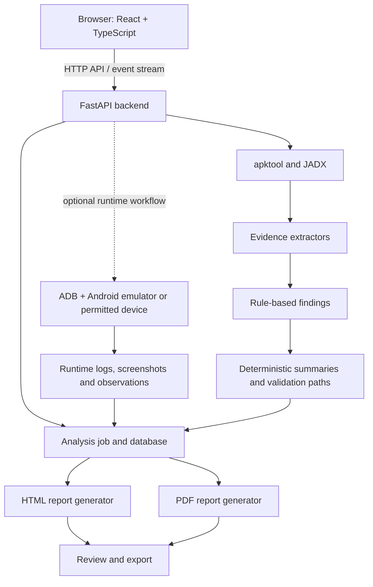

# DY-MASA — Android Application Security Assessment

DY-MASA is an evidence-backed platform for assessing Android APKs. It combines **static APK analysis** with an optional **runtime-analysis workflow** using Android Debug Bridge (ADB), then organizes observations into reviewable findings and exports HTML and PDF reports.

The goal is to make Android application assessment more organized and traceable: upload an APK, follow the analysis job, inspect findings and their supporting evidence, and review the generated report.

> **Scope:** DY-MASA supports security assessment and triage. It does not prove that every finding is exploitable, replace a full manual mobile penetration test, or guarantee detection of every vulnerability. Use it only with APKs and devices you own or are authorized to test.

## Contents

- [What it does](#what-it-does)
- [How it works](#how-it-works)
- [Features](#features)
- [Technology stack](#technology-stack)
- [Architecture](#architecture)
- [Requirements](#requirements)
- [Setup on Fedora or Linux](#setup-on-fedora-or-linux)
- [Run DY-MASA](#run-dy-masa)
- [Run an assessment](#run-an-assessment)
- [Stop the services](#stop-the-services)
- [Configuration](#configuration)
- [API and developer tools](#api-and-developer-tools)
- [Project layout](#project-layout)
- [Limitations](#limitations)
- [Security notes](#security-notes)

## What it does

Android application security reviews can involve several separate tasks: decoding an APK, inspecting its manifest and code, sorting useful evidence from raw tool output, deciding which risks deserve attention, and writing a report.

DY-MASA brings much of that workflow into one local web application. It creates a tracked job for each APK, runs analysis tools, stores evidence and findings, displays job progress, and generates reports. When an Android runtime target is configured and ready, a separate dynamic workflow can install and launch the APK and collect runtime observations.

## How it works

### 1. Upload and track the APK

The web interface sends the APK to the FastAPI backend. The backend validates the upload, creates an analysis job, calculates a SHA-256 digest, and stores the file in the local storage area. Jobs and their stages are tracked in the configured database.

### 2. Decode and decompile

- **apktool** decodes the APK's Android resources and manifest.
- **JADX** decompiles DEX bytecode into Java-like source where possible.
- **Ghidra** can optionally analyze native libraries when it is enabled, configured, and native libraries are present.

### 3. Extract security evidence

Python analysis modules inspect APK-derived files and create structured evidence. Examples include manifest metadata, permissions, application flags, exported components, deep links, possible hardcoded secrets, and selected insecure implementation patterns.

### 4. Generate findings and validation guidance

Deterministic rules evaluate the extracted evidence and generate findings with severity estimates, explanations, remediation guidance, and links to supporting evidence. The reasoning module summarizes findings and proposes manual validation paths. It is **not currently a live LLM integration**.

### 5. Optional runtime analysis

The DY-MASA runtime workflow uses ADB with a ready Android emulator or an explicitly permitted physical test device. It can record device details, installation and launch results, screenshots, logcat captures, crash-related observations, and selected non-destructive attack-surface validation results. Runtime observations are stored as evidence and reports can be regenerated to include them.

### 6. Review and export

The dashboard displays job progress, findings, evidence, artifacts, and reports. The backend generates HTML and PDF reports that include findings, supporting evidence, validation guidance, and scope limitations.

## Features

- APK upload validation and SHA-256 identification.
- Background analysis jobs with recorded status and stages.
- APK decoding with apktool and decompilation with JADX.
- Manifest and permission analysis.
- Application-configuration and exported-component checks.
- Deep-link and selected code-risk analysis.
- Evidence-backed findings with severity estimates and remediation guidance.
- Deterministic summaries and manual validation paths.
- Optional Ghidra analysis for native libraries.
- Optional Android runtime workflow through ADB.
- Runtime logcat capture, log classification, crash-related observations, and screenshots.
- Dynamic device status and read-only storage reporting.
- Job history, stage timelines, artifacts, and event streaming.
- HTML and PDF report generation.
- Health endpoint and environment-check helper.
- PostgreSQL support with a documented SQLite fallback for a local, single-user demo.

## Technology stack

| Technology | Purpose |
| --- | --- |
| **Python** | Coordinates the analysis pipeline, evidence extraction, finding generation, runtime orchestration, and report generation. |
| **FastAPI + Uvicorn** | Exposes the backend HTTP API and serves the application logic. |
| **Pydantic Settings** | Loads application configuration from environment variables and the local `.env` file. |
| **SQLAlchemy** | Maps analysis jobs, stages, evidence, findings, artifacts, events, and reports to database records. |
| **PostgreSQL / SQLite** | Persists structured application data. PostgreSQL is the normal database; SQLite is available as a local demo fallback. |
| **React + TypeScript** | Builds the browser-based user interface. |
| **Vite** | Runs the frontend development server and builds frontend assets. |
| **Tailwind CSS** | Styles the frontend. |
| **TanStack Query, Wouter, Lucide React** | Support frontend data handling, routing, and icons. |
| **Java** | Runs the Java-based Android analysis tools. |
| **apktool** | Decodes APK resources and Android manifest data. |
| **JADX CLI** | Decompiles Android DEX bytecode for source-level inspection. |
| **Android Debug Bridge (ADB)** | Communicates with the configured emulator or permitted physical test device for runtime observations. |
| **Ghidra (optional)** | Supports headless static analysis of native libraries when configured. |
| **ReportLab** | Generates PDF reports. |
| **HTML generation** | Produces browser-readable report files. |

The deterministic reasoning module is implemented in Python. The project does not currently require an external AI service or LLM to generate findings.

## Architecture



Static analysis and runtime analysis serve different purposes. Static analysis inspects APK-derived files without running the application. Runtime analysis records selected behavior observed while the APK is installed and launched on an Android target.

## Requirements

Install or configure the following components before running the project:

- Python and pip.
- Node.js and npm.
- Java.
- apktool and its JAR file.
- JADX CLI and its JAR file.
- PostgreSQL for the normal database setup, or SQLite for a local demo.
- Android SDK Platform Tools (ADB) for runtime analysis.
- Android Emulator and a configured AVD if you plan to use an emulator.
- Ghidra only if you want to enable its optional native-library analysis.

Exact executable and JAR paths are configurable. Use [`.env.example`](.env.example) as the template; do not copy example placeholder paths unchanged.

## Setup on Fedora or Linux

Run commands from the repository root.

### 1. Configure the environment

Create your local environment file:

```bash
cp .env.example .env
```

Edit `.env` and set the paths and database settings for your machine. The sample file contains placeholder paths for apktool, JADX, Android SDK tools, and optional Ghidra.

### 2. Check the local environment

```bash
bash work/check-environment.sh
```

Review any missing dependencies or incorrect paths reported by the helper before starting the application.

### 3. Install backend dependencies

Use the repository's Python environment and install the backend requirements:

```bash
python -m venv .venv
source .venv/bin/activate
pip install -r backend/requirements.txt
```

If your shell or Python installation requires a different virtual-environment setup, use the equivalent commands for your environment.

### 4. Install frontend dependencies

```bash
cd frontend
npm install
cd ..
```

### 5. Configure the database

By default, the backend uses PostgreSQL settings from `.env.example`. Ensure the configured database exists and that the credentials are valid.

For a local, single-user demonstration where PostgreSQL is unavailable, the runbook documents this SQLite fallback:

```bash
export MOBILE_PENTEST_DATABASE_URL="sqlite:///./storage/masa.sqlite3"
```

SQLite fallback is intended for a local demo, not as a replacement for the normal PostgreSQL deployment.

For additional details, see [RUNBOOK.md](RUNBOOK.md).

## Run DY-MASA

Start the backend from the repository root in the first terminal:

```bash
bash work/start-backend.sh
```

Start the frontend in a second terminal:

```bash
bash work/start-frontend.sh
```

Open the dashboard:

**http://127.0.0.1:5173**

The backend health endpoint is:

**http://127.0.0.1:8000/api/health**

FastAPI's interactive API documentation is available at:

**http://127.0.0.1:8000/docs**

The backend and frontend are separate local services; both must be running for the web interface to work.

## Run an assessment

1. Open the dashboard.
2. Upload an APK you own or have permission to assess.
3. Follow the job status and pipeline timeline while the static analysis runs.
4. Review the generated findings and open their supporting evidence.
5. Download or open the generated HTML/PDF report.
6. If you also want runtime observations, configure ADB and a permitted Android target, then use the Dynamic page for the selected completed static-analysis job.
7. Review runtime artifacts and regenerate/inspect the updated report.

For a physical Android test device on Fedora, the runbook recommends installing Android Platform Tools if needed:

```bash
sudo dnf install android-tools
```

Enable Developer Options and USB debugging on a dedicated test phone, connect it, accept the device authorization prompt, and confirm that ADB recognizes it:

```bash
adb devices
```

The runtime configuration does not automatically permit every physical device. Review `MOBILE_PENTEST_DYNAMIC_ALLOW_PHYSICAL_DEVICE` and `MOBILE_PENTEST_DYNAMIC_DEVICE_SERIAL` in your local configuration before running dynamic analysis.

## Stop the services

- In each terminal running the backend or frontend, press **Ctrl+C**.
- If you started an Android emulator separately and no longer need it, close the emulator separately.
- Stopping the web servers is **not** the same as cancelling an active runtime analysis job. The dynamic API currently documents a start action but not a dedicated dynamic-run stop endpoint; do not assume that stopping a terminal gracefully cancels every running analysis step.

## Configuration

Configuration is loaded using the `MOBILE_PENTEST_` environment-variable prefix and the local `.env` file. See [`.env.example`](.env.example) for the full list.

Important settings include:

| Setting | Purpose |
| --- | --- |
| `MOBILE_PENTEST_DATABASE_URL` | Optional explicit database URL, including the documented SQLite demo fallback. |
| `MOBILE_PENTEST_POSTGRES_*` | PostgreSQL connection settings. |
| `MOBILE_PENTEST_JAVA_PATH` | Java executable path. |
| `MOBILE_PENTEST_APKTOOL_JAR_PATH` | apktool JAR path. |
| `MOBILE_PENTEST_JADX_JAR_PATH` | JADX JAR path. |
| `MOBILE_PENTEST_GHIDRA_ENABLED` | Enables or disables optional Ghidra support. |
| `MOBILE_PENTEST_GHIDRA_HEADLESS_PATH` | Path to Ghidra's headless analysis executable. |
| `MOBILE_PENTEST_ANDROID_SDK_PATH` | Android SDK location. |
| `MOBILE_PENTEST_ADB_PATH` | ADB executable path. |
| `MOBILE_PENTEST_EMULATOR_PATH` | Android Emulator executable path. |
| `MOBILE_PENTEST_AVD_NAME` | Configured Android Virtual Device name. |
| `MOBILE_PENTEST_DYNAMIC_DEVICE_SERIAL` | Optional preferred ADB device serial. |
| `MOBILE_PENTEST_DYNAMIC_ALLOW_PHYSICAL_DEVICE` | Whether a physical device may be selected as a runtime target. |
| `MOBILE_PENTEST_DYNAMIC_SCAN_PERSONAL_STORAGE` | Controls the optional shared-storage scan setting; keep disabled unless explicitly required for an authorized test. |
| `MOBILE_PENTEST_MAX_UPLOAD_BYTES` | Maximum upload size; default is 300 MiB. |
| `MOBILE_PENTEST_MAX_CONCURRENT_ANALYSIS_JOBS` | Maximum concurrent analysis jobs; default is one. |
| `MOBILE_PENTEST_ENABLE_TERMINAL` | Enables the optional local terminal endpoint; disabled by default. |
| `MOBILE_PENTEST_TERMINAL_TOKEN` | Private token required when the optional terminal is enabled. |

Do not commit `.env`, credentials, tokens, APK samples containing private data, or generated analysis artifacts.

## API and developer tools

The API is served under `/api`. Useful routes include:

| Route | Purpose |
| --- | --- |
| `GET /api/health` | Backend and dependency health information. |
| `POST /api/jobs` | Upload an APK and create an analysis job. |
| `GET /api/jobs` | List analysis jobs. |
| `GET /api/jobs/{job_id}` | Retrieve one job. |
| `GET /api/jobs/{job_id}/timeline` | Retrieve the job's recorded stages. |
| `GET /api/jobs/{job_id}/events` | Stream job events using Server-Sent Events. |
| `GET /api/jobs/{job_id}/artifacts` | List job artifacts. |
| `POST /api/jobs/{job_id}/dynamic/start` | Start the optional runtime workflow for a job. |
| `GET /api/dynamic/status` | Inspect ADB/emulator/device status. |
| `GET /api/dynamic/storage` | Read-only storage summary for a ready target. |

The interactive OpenAPI documentation at `/docs` is the most reliable place to inspect the routes and schemas exposed by the running version.

A CLI entry point is also provided for running analysis on an APK path:

```bash
export PYTHONPATH=".:backend"
python -m app.cli.analyze_apk "/absolute/path/to/authorized-app.apk"
```

On Windows PowerShell, set the Python path using:

```powershell
$env:PYTHONPATH = ".;backend"
```

## Project layout

| Path | Responsibility |
| --- | --- |
| `frontend/` | React/TypeScript user interface. |
| `backend/app/api/routes/` | FastAPI route handlers for health, jobs, dynamic analysis, and the optional terminal. |
| `backend/app/core/` | Application settings and configuration. |
| `backend/app/db/` | Database models and session setup. |
| `backend/app/services/` | Job orchestration, scheduling, event handling, and analysis services. |
| `analysis/` | APK decompilation integration, manifest/code evidence extraction, finding generation, and optional native analysis. |
| `dynamic/` | ADB client, emulator/device management, runtime orchestration, log parsing, and classification. |
| `ai/reasoning.py` | Deterministic structured summaries and manual validation paths. |
| `reports/` | HTML and PDF report generators. |
| `work/` | Local startup and environment-check helper scripts. |
| `tests/` | Automated tests. |
| `storage/` | Local uploads, per-job workspaces, generated reports, and other runtime data. |

Generated files and local data under `storage/` are runtime artifacts, not source code.

## Limitations

- Results depend on the APK, tool versions, configuration, and the evidence extractors' coverage.
- A requested permission, exported component, deep link, suspicious string, or code pattern is not by itself proof of a vulnerability.
- Severity is an estimate for triage and may require adjustment after manual review.
- JADX output may be incomplete or imperfect for some APKs.
- Optional Ghidra analysis is limited to configured native-library workflows; it does not independently prove a vulnerability.
- Runtime analysis covers selected installation, launch, logging, crash, and attack-surface observations. It is not full interactive application testing.
- The current reasoning engine is deterministic and evidence-constrained, not a live LLM.
- DY-MASA does not automatically perform exploit chains, credential attacks, or uncontrolled external network testing.

## Security notes

- Only analyze APKs you own or are authorized to test.
- Use a dedicated emulator or test device whenever possible.
- Review the device selected by ADB before starting a dynamic run.
- The ADB client blocks selected destructive operations, including uninstall, wipe/reset/format operations and shell operations such as `pm clear` and `rm -rf`. This is a guardrail, not a substitute for using an isolated test target.
- The optional terminal feature is disabled by default. If enabled, it is a trusted local-shell convenience—not a secure sandbox for untrusted users or arbitrary commands. Do not expose it to a public network; use an isolated VM/container and a separate OS user for stronger separation.
- Bind the development servers to loopback unless you have deliberately configured and secured another deployment model.
- Keep secrets in local environment configuration, not in source control.

## Related documentation

- [Runbook](RUNBOOK.md) — setup, device configuration, and operating notes.
- [Technical presentation brief](TECHNICAL_PRESENTATION_BRIEF.md) — scope and current implementation limitations.
- [Presentation notes](PRESENTATION_NOTES.md) — presentation-focused notes.

---

DY-MASA is an ongoing project. This README describes the code paths and configuration currently documented in the repository; verify the local environment and target-device setup before a demonstration or assessment.
